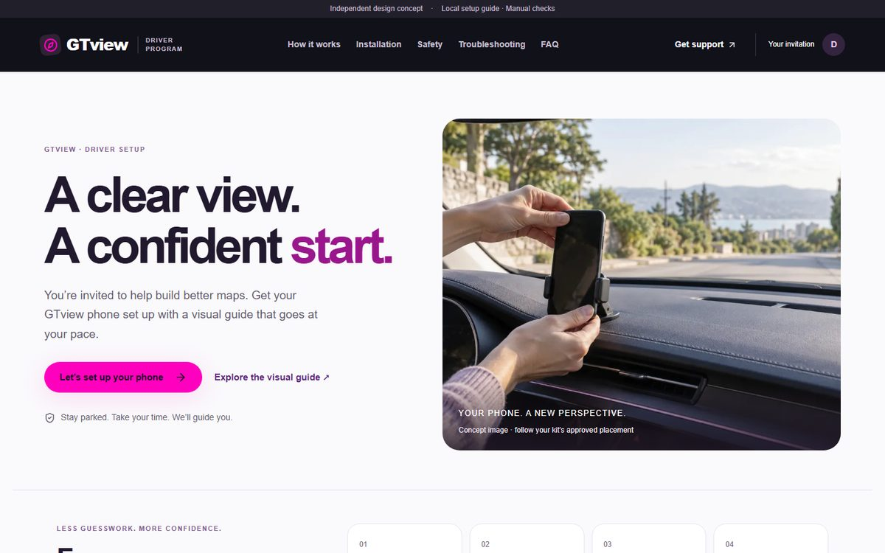
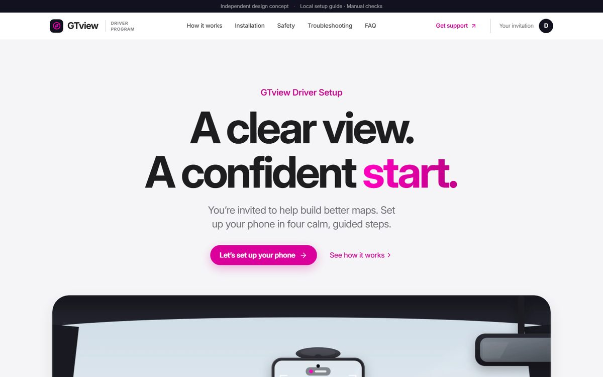
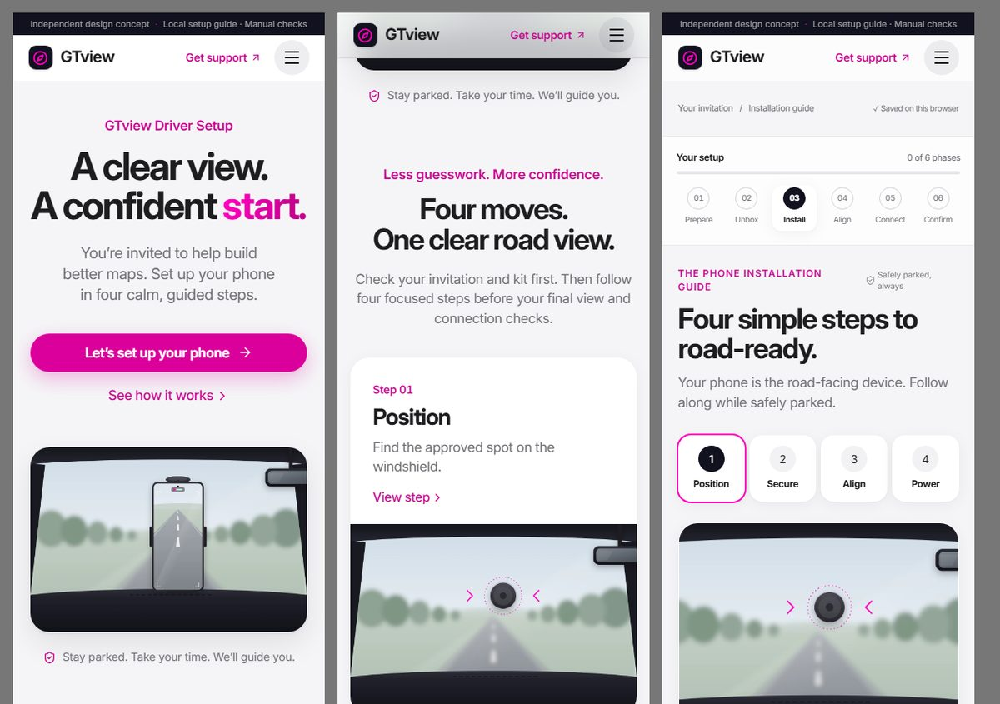

# GTview — Driver Setup Portal

A responsive, step-by-step guide that helps a driver set up a road-facing phone on a windshield suction-cup mount, in six short phases: **Prepare → Unbox → Install → Align → Connect → Review**. It includes an interactive mount demo, progress saved on the device, manual diagnostics, optional photos, troubleshooting help and downloadable support drafts.

## Live sites

Two versions are published side by side, so the redesign can be compared with the original.

| Version | Link | Source |
| --- | --- | --- |
| **Current: Apple principles × Lyft theme** | **https://vamsi9090.github.io/gtview/new/** | [`main`](https://github.com/vamsi9090/gtview/tree/main) |
| Original design | https://vamsi9090.github.io/gtview/ | [`classic`](https://github.com/vamsi9090/gtview/tree/classic) |

**Source code:** https://github.com/vamsi9090/gtview

Both are hosted free on GitHub Pages and rebuilt on every push to `main`. See [How the sites are published](#how-the-sites-are-published).

> Independent design concept. Not affiliated with GTview, Google or Lyft. Unapproved operational details appear as dashed **pending** chips rather than invented values.

## Design: Apple principles × Lyft theme

The interface follows Apple's Human Interface principles, styled in Lyft's brand palette, without changing any guide behaviour.

| Before | After |
| --- | --- |
|  |  |



| Principle | How it shows up |
| --- | --- |
| Clarity and hierarchy | System type (SF on Apple devices, self-hosted Inter elsewhere) with size-specific tracking; one bold message per section |
| Deference | Translucent sticky header so content stays primary; depth from soft shadows instead of outlines |
| Direct, instant feedback | Buttons and cards respond on press; segmented controls for step pickers and tabs |
| Wayfinding | Bottom toolbar on phones keeps the next action in reach; progress stays visible |
| Honesty | Unapproved operational details render as dashed **pending** chips, never as invented values |
| Brand | Lyft pink (`#FF00BF`) for actions and highlights on near-black ink; accessible pink shades for text |
| Accessibility | WCAG AA contrast on every text pair; honours reduced motion, reduced transparency, increased contrast and forced colours |
| Privacy | No third-party requests: fonts are bundled with the site |

Theme lives in [`app/apple-lyft.css`](app/apple-lyft.css), loaded after the base styles.

## Tech stack

React 19, TypeScript, [Vinext](https://www.npmjs.com/package/vinext) (Next.js App Router conventions on top of Vite), Tailwind CSS 4, Radix/Shadcn UI, and Zod. It builds as a Cloudflare Worker and is also exported to static files for GitHub Pages — see [How the sites are published](#how-the-sites-are-published).

## Quick start (run it locally)

Install Node.js 22+ and npm, then from the repo root:

```sh
npm ci
npm run dev
```

Open the local URL printed in the terminal. No API keys or database are required for the current checklist features.

To build and run a production build locally:

```sh
npm run build
npm start
```

## Project structure

| Location | Purpose |
| --- | --- |
| `app/` | Routes, metadata, global styles |
| `components/gtview/` | Homepage, six-phase guide, mount demo, review, support |
| `components/ui/` | Reusable UI primitives |
| `lib/gtview/` | Content, completion rules, browser photos, disabled analytics, base-path helper |
| `public/assets/` | WebP photographs and concept assets |
| `scripts/` | Static export for GitHub Pages |
| `tests/` | Progress and server-render checks |
| `docs/` | Product notes, approval checklist, validation notes |
| `worker/` | Cloudflare Worker entrypoint |
| `build/` | Build metadata helper |
| `db/`, `drizzle/` | Optional database scaffolding, unused by the current guide |
| `vite.config.ts` | Build/dev configuration (includes inline Cloudflare Worker bindings) |

## Customize

- Branding/navigation: `components/gtview/shell.tsx`
- Homepage: `components/gtview/home.tsx`
- Installation flow: `components/gtview/install.tsx`
- Interactive mount demo: `components/gtview/mount-lab.tsx`
- Copy, FAQs, placeholders: `lib/gtview/content.ts`
- Colors/layout: `app/apple-lyft.css` (theme layer), `app/globals.css` and `app/phone-guide.css`
- Page title/description: `app/layout.tsx`

## Validate

```sh
npm run typecheck
npm test
```

Tests build the project, check progress rules, and render every route. They do not test a physical device or simulate real browser interactions.

## How the sites are published

GitHub Pages serves only static files, and this app is built around React Server Components, so each version is exported to a fully static bundle first, then published. No paid hosting, no external service, no account beyond GitHub.

```sh
npm run build:pages                                  # writes gh-pages-dist/ for /gtview
GH_PAGES_BASE_PATH=/gtview/new npm run build:pages   # same build, served under /gtview/new
```

On every push to `main`, `.github/workflows/deploy-pages.yml`:

1. builds the `classic` branch at `/gtview/` (the original design),
2. builds `main` at `/gtview/new/` (the current design),
3. combines both into one Pages artifact and publishes it.

| To update | Do this |
| --- | --- |
| The current design (`/gtview/new/`) | Push to `main` |
| The original design (`/gtview/`) | Push to `classic`, then run the workflow from the Actions tab (or `gh workflow run deploy-pages.yml`) |

### What the export does

`scripts/build-static.mjs` builds the app, starts the production server locally, and saves each route's two responses to disk:

| File | Served when |
| --- | --- |
| `<route>.html` | A visitor loads the URL directly or refreshes |
| `<route>.rsc` | The client router navigates between pages without a reload |

Routes are discovered from the `app/` directory, so a new `app/<name>/page.tsx` is picked up automatically. Client assets, `favicon.svg`, a `404.html`, and `.nojekyll` are copied alongside.

It does not use `vinext build --prerender-all`: that flag's route discovery crawls from `/`, which returns 404 once `basePath` is set for this build, so it finds no routes.

### About the base path

A GitHub Pages project site lives at `https://vamsi9090.github.io/gtview/`, not at a domain root, so every absolute path needs the `/gtview` prefix. `next.config.ts` sets `basePath`/`assetPrefix` when `GH_PAGES_BUILD=true`, which covers framework-generated links, scripts, and styles.

It does **not** cover hardcoded `public/` paths — a plain `` would break. Those go through `withBasePath()` in `lib/gtview/base-path.ts`. **Use it for any new `public/` asset reference.**

The prefix defaults to `/gtview` and can be overridden with the `GH_PAGES_BASE_PATH` environment variable, which both `next.config.ts` and `scripts/build-static.mjs` read. Renaming the repository means changing that default in both files.

### Known limitation

Hovering the header logo triggers a prefetch of `/gtview.rsc`, which 404s — vinext builds that URL without the separator for the root route. Navigation still works (the router falls back to a normal page load); the failed request is visible only in devtools.

### Deploying to Cloudflare Workers instead

The project still builds as a Worker (`worker/index.ts`, `vite.config.ts`), which adds real server rendering and image optimization. Import the repo at [dash.cloudflare.com](https://dash.cloudflare.com) under **Workers & Pages → Create → Import a Git repository** with build command `npm run build`. The free tier covers this app's traffic; the GitHub Pages setup above avoids signing up for another service at all.

## Data and limitations

Progress and support drafts use local storage; optional photos use IndexedDB. Data stays in that browser and is not synchronized, and clearing browser data removes it.

This is an illustrative preview: there is no real camera access, calibration, activation, support submission, reward verification, or analytics transmission. Bracketed hardware instructions and contact information require approved program details, and images are concept assets, not mounting specifications.

## License

No project-wide open-source license has been selected yet. Public visibility on GitHub does not itself grant an open-source license — choose one (e.g. MIT) before inviting reuse, and keep the third-party notices in `vendor/` and in dependencies.
